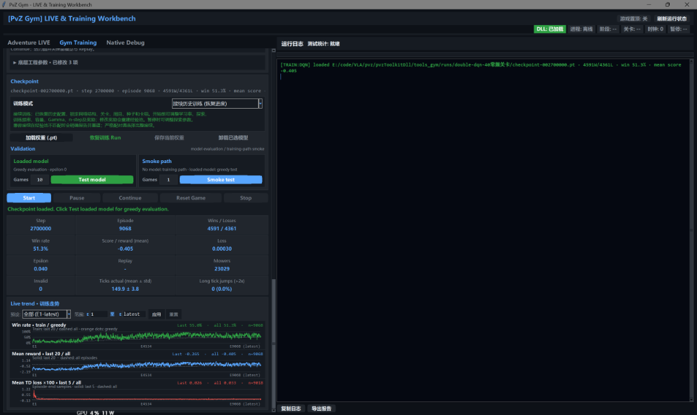
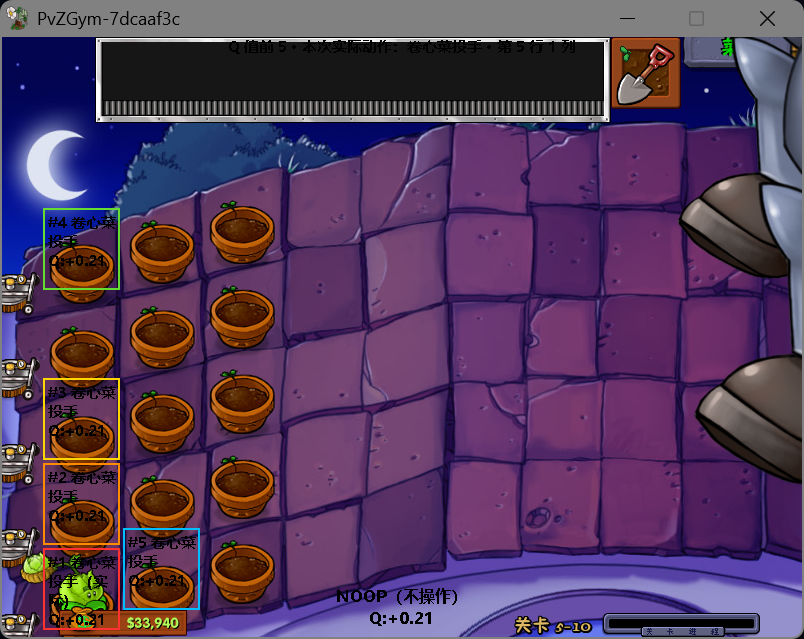

# PvZ RL

在 Windows 上通过真实《植物大战僵尸》进程进行强化学习。包含 Gymnasium 环境、Double DQN、固定种子评估和训练工作台。

| 训练与监控工作台 (Workbench GUI) | 实时决策与动作 Q 值可视化 (Live Overlay) |
| :---: | :---: |
|  |  |

支持 Windows 10/11 x64、64 位 Python 3.10–3.12，以及 **PvZ retail 1.2.0.1065 的已验证布局**。游戏本身是 32 位，Python 和原生 DLL 是 64 位。中文翻译版必须通过代码签名检查；GOTY、1.0.0.1051 和未知改版不属于首版完整训练支持范围。

## 为什么选择原版《植物大战僵尸》做强化学习？

在众多复杂控制与决策环境中，选择 PvZ 作为强化学习研究载体有着非常现实且独特的考量：

* **消费级硬件即刻开跑**：游戏底层运行极为轻量，单张个人消费级显卡即可并发拉起多个游戏沙箱环境与模型训练，无需昂贵的大规模集群。
* **国民级经典，直观易懂**：几乎每个人都玩过这款游戏，规则人人皆知。无需复杂的统计图表，一眼就能直观看出 AI 是在胡乱试错，还是真正掌握了合理布阵、控费防守的高阶逻辑。
* **极佳的天然关卡课程**：从单路基础防御、全草坪铺开，到黑夜、泳池、浓雾、屋顶，游戏自带 50 关极其丝滑平密的难度递进，是研究强化学习课程学习的绝佳试验场。
* **严苛的跨场景泛化检验**：白天依赖向日葵与天降阳光，黑夜依赖阳光菇与 0 费小喷菇，泳池增加水路两栖，浓雾遮挡视线，屋顶斜坡改变弹道——环境机制在各大关剧烈变化，能极其硬核地检验模型的跨场景泛化与抗遗忘能力。
* **情怀**：它是无数玩家的童年回忆。


## 1. 安装

先安装 Git、**64 位 Python 3.12**（含 `py` 启动器）和兼容的 NVIDIA 驱动。使用已有 Python 3.10–3.12 时，可给安装脚本传入 `-PythonExe` 指定解释器。克隆后在仓库根目录运行安装脚本：

```powershell
git clone https://github.com/yych00/pvz_rl.git
cd pvz_rl
powershell -ExecutionPolicy Bypass -File scripts/setup.ps1
```

默认 Python 3.12、CUDA 12.1 版 PyTorch；NVIDIA GPU 需有兼容驱动。安装器从 GitHub 下载与代码版本匹配的 DLL，并校验 SHA256。私有仓库需要有访问权限的 GitHub 登录（Git Credential Manager，或环境变量 `GH_TOKEN` / `GITHUB_TOKEN`）；公开 Release 可直接下载。尚未发布 Release 的检出使用 `-BuildNative`，也可用 `-NativeArchive` 指定本地发布包。[开发与构建](docs/development.md)

**建议使用 CUDA 版 PyTorch 进行训练。** CPU 模式下，模型计算和多环境采样争用处理器，可能导致训练或 GUI 长时间无响应，表现为“卡死”；不建议用 CPU 跑完整训练。`-TorchIndex cpu` 主要供无 NVIDIA GPU 的用户进行离线检查和有限的环境调试。

## 2. 放置游戏

自行准备完整兼容游戏目录（可在 [游戏资源下载 - 植僵工具箱](https://pvz.tools/download/) 中查找对应的 1.2.0.1065 版本），放到：

```text
game/pvz-1.2.0.1065/PlantsVsZombies.exe
game/pvz-1.2.0.1065/main.pak
game/pvz-1.2.0.1065/…原游戏附带的 DLL、properties 等文件
```

**不要只复制 EXE。** 游戏也可保留在仓库外，在根目录 `.env` 设置 `PVZ_GAME_EXECUTABLE` 的绝对路径。仓库不提供游戏下载。[游戏、版本与存档配置](docs/game_setup.md) · [游戏目录说明](game/README.md)

## 3. 检查并准备存档

```powershell
.venv/Scripts/python.exe -m scripts.doctor --skip-save
.venv/Scripts/python.exe -m scripts.prepare_training_save
.venv/Scripts/python.exe -m scripts.doctor
```

工具生成专用 `PvZRL` profile，无需个人通关存档。训练使用独立游戏副本，原游戏和个人存档保持原样。

## 4. 训练

GUI：双击 `run_workbench.bat`。训练参数面板提供“准备训练存档”；“单开可视化训练”可查看 Q 热力图。

```powershell
.venv/Scripts/python.exe -m train.dqn.train --level-id 4 --playthrough 1 --simulation-mode turbo --num-envs 1 --total-steps 10000 --run-dir runs/first-run --device cuda
```

使用 `--num-envs 2` 可进行双环境训练。训练建议明确使用 `--device cuda`；内存需求随 Replay、模型和环境数增长。训练胜率与 greedy 评估分开记录，固定种子比较使用下面的手动评估命令。

## 5. 恢复与评估

```powershell
.venv/Scripts/python.exe -m train.dqn.train --resume-run runs/first-run --total-steps 20000 --device cuda
.venv/Scripts/python.exe -m train.dqn.evaluate runs/first-run/latest.pt --seed-start 10001 --seed-count 4 --simulation-mode turbo --device cuda
```

使用 Run 中实际存在的 checkpoint 文件。[DQN 保存与恢复参考](docs/dqn_reference.md)

## 研究与技术报告

本项目包含对商业游戏逆向时钟控制、混合状态空间建模、动作空间掩码及多关卡自适应采样的深入探索。

详见专题文档：👉 **[研究与技术报告 (Research & Technical Report)](research/README.md)**

<details>
<summary><b>展开查看核心研究方向概览</b></summary>

- **游戏时钟控制**：Turbo 主循环控制、同步快照与实例隔离。详见 [原生 API 文档](docs/native_api.md)。
- **状态空间表征**：固定 6×9 网格、三层植物、僵尸实体、Boss 本体与独立冰火球，以及雾过滤。详见 [观测契约](docs/observation.md)。
- **动作空间与非法动作掩码**：193 维选卡 + 757 维战局动作，原生合法性校验过滤无效探索。详见 [动作契约](docs/action_space.md)。
- **Double DQN 算法体系与结构化网络**：v9 实体-注意力网络、物理时钟动态折扣、SumTree PER 与按需打分。详见 [DDQN 专项报告](research/ddqn_report.md) · [算法配置参考](docs/dqn_reference.md)。
- **多关卡自适应课程学习**：基于近期训练胜率动态调度关卡采样权重，课程配置覆盖冒险 50 关及两周目，不代表所有组合都已完成实机验证。详见 [自适应采样](docs/adaptive_level_sampling.md)。
- **异步 Actor-Learner 并发架构**：多进程独立沙箱采样与 GPU 训练解耦。详见 [异步架构分析](docs/actor_learner_async.md)。

</details>

## 源码与许可

```text
pvz_rl/
  python/pvz_gym/    Gym 环境、运行时、动作与观察
  native/           原生源码、测试和 vendor 依赖
  train/dqn/        Double DQN 与训练公共模块
  eval/             评估与随机基线运行器
  agents/           随机基线、GUI 使用的脚本策略
  workbench/        训练、评估和调试 GUI
  scripts/          安装、doctor、准备存档、构建、发布打包
  tests/            离线测试与显式实机验收
  docs/             使用、算法和原生实现文档
  research/         算法设计、逆向工程与技术研究报告
  examples/         最小环境与训练示例
  game/README.md    游戏准备说明；游戏文件自行放置并忽略
  local/            生成的存档模板（忽略）
  runtime/          训练与评估副本（忽略）
  bin/              安装或构建的 DLL（忽略）
  runs/             训练结果（忽略）
```

环境位于 `python/pvz_gym`，权威游戏事实与动作位于 `native`，训练位于 `train/dqn`，GUI 位于 `workbench`。原生依赖已收入 `native/vendor`，构建无需原项目。

[完整文档导航](docs/README.md) · [研究报告](research/README.md) · [构建与测试](docs/development.md)

代码沿用 GPL-3.0，第三方来源见 [THIRD_PARTY_NOTICES.md](THIRD_PARTY_NOTICES.md)。代码许可证不授予游戏本体的分发权；游戏文件和本地训练产物被 Git 忽略。

## 未来展望 (Vision & Roadmap)

打造 PvZ RL 的初衷，绝不仅仅是让模型在有限关卡里依靠高容错率“勉强通关”，而是探索复杂离散空间与长程时序决策下强化学习的智能边界。

我们期待见证的终极形态，是一个**真正深刻理解每种植物与僵尸生克机制、懂得经济留白与战术节律、能够自主推演精密防线**的战术智能体。

算法的终极试金石是人类玩家智慧的极限殿堂——**泳池无尽模式（Survival: Endless）**。我们期望看到智能体在极高密度的红眼与特种僵尸潮中，从容施展出**残白搭梯、合理运营、阵容修复**等如艺术品般精密的战术素养。

## 致谢

- [lmintlcx/pvztoolkit](https://github.com/lmintlcx/pvztoolkit)：本项目原生底层修改与内存注入逻辑的基础。
- [ruslan831/PlantsVsZombies-decompilation](https://github.com/ruslan831/PlantsVsZombies-decompilation) 等社区资料：存档格式与部分字段语义的参考来源；具体使用范围见 [第三方说明](THIRD_PARTY_NOTICES.md) 与相关原生文档。

