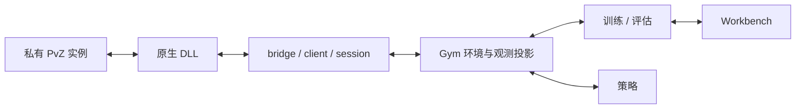

# 系统结构与职责

本仓库读取并控制真实的 32 位 PvZ 游戏，Windows x64 Python 通过 x64 DLL 调用原游戏逻辑。模型的观测编码、奖励与优化发生在 Python，游戏事实和动作合法性由原生层提供。

## 模块与依赖

| 目录 | 职责 |
| --- | --- |
| `native/` | 进程内存、原版函数调用、动作校验、快照、时钟与 C ABI |
| `python/pvz_gym/` | bridge、client/session、Gym 环境、动作/观测投影、私有实例与存档 |
| `agents/` | 随机策略和 GUI 实际使用的脚本策略 |
| `eval/` | 环境回合执行、greedy/基线评估与指标 |
| `train/`、`train/dqn/` | 公共采样/课程/存储模块，Double DQN 与控制器 |
| `workbench/` | Tk GUI、训练/评估入口、LIVE 与原生诊断 |
| `scripts/` | 安装、doctor、训练模板、构建和发布 |
| `tests/` | 离线契约测试与显式实机验收 |

上层通过 `pvz_gym` 调用原生 DLL；`import pvz_gym` 不加载训练器或 GUI。少数历史兼容模块按需转发评估入口，不应据此把评估逻辑移入底层环境。

## 游戏、存档与数据

`PVZ_GAME_EXECUTABLE` 指向用户提供的完整游戏安装；相对配置以仓库根目录解析。准备工具生成只读模板，训练/手动评估使用私有 EXE 与资源副本。可写 profile 位于 `%ProgramData%/PopCap Games/PvZGym-<标识>/userdata`，不是 `runtime/` 下的资源目录，详见[游戏配置](game_setup.md)。

`runtime/` 保存实例副本和管理信息；`runs/` 保存模型、Replay、配置与日志；两者都被 Git 忽略。source fingerprint 用于判断已验证资源来源是否变化，不能取代版本签名检查。

训练入口创建或明确绑定自己的实例，防止自动附加个人游戏。Workbench 的 LIVE/原生诊断属于调试功能，会作用于其明确绑定的游戏；它与私有训练入口的生命周期不同。

## 采样、学习与界面

游戏 worker 各自持有 DLL/环境，返回真实 tick、观测、合法 mask 和事件。主控 Actor 使用独立策略推理并向共享 Replay 写入合法数据，后台 Learner 更新 Online/Target 并发布权重；多关调度保留每局的关卡、周目、种子与实际卡组。详见[Actor–Learner](actor_learner_async.md)。

动作 ID、原始 native schema、Python 观测 schema 与网络版本分别验证。GPU 计算不会代替原生模拟，tick 加速也不会改变奖励的游戏时间单位。奖励口径见[奖励](rewards.md)，序列化和线程边界见[原生 API](native_api.md)。

## Workbench 兼容层

`workbench/legacy/` 中仍安装的补丁是 GUI 运行依赖，加载顺序有意义，不能凭目录名删除；PPO/Dreamer 占位入口与原项目的逆向/截图工具未包含在项目中。
