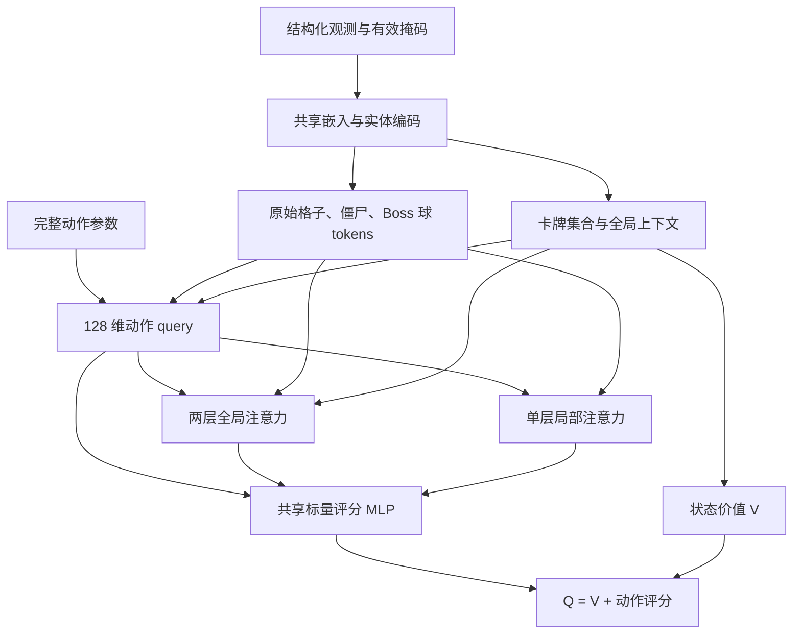

# Double DQN 算法与实现

当前实现为结构化观测上的 Double DQN：Online 网络选动作、Target 网络计算 bootstrap，使用按真实游戏 ticks 折扣的 n-step 回报、PER、Huber loss 和定期硬同步。新训练采用 `transition_dense` 奖励和 Actor–Learner 架构。保留的旧网络类不等同于公共训练兼容入口。

## 安装与入口

按[安装说明](development.md)安装 CUDA 版 PyTorch 和 DLL，按[游戏配置](game_setup.md)准备完整 1065 游戏与存档模板。建议明确指定 `--device cuda`；CPU 训练可能让采样和 GUI 长时间无响应。

在仓库根目录运行：

```powershell
.venv/Scripts/python.exe -m train.dqn.train --level-id 4 --playthrough 1 --simulation-mode turbo --num-envs 1 --total-steps 10000 --run-dir runs/first-run --device cuda
.venv/Scripts/python.exe -m train.dqn.train --resume-run runs/first-run --total-steps 20000 --device cuda
.venv/Scripts/python.exe -m train.dqn.evaluate runs/first-run/latest.pt --seed-start 10001 --seed-count 4 --simulation-mode turbo --device cuda
```

GUI 使用 `run_workbench.bat`，提供关卡池、选卡、奖励、评估和训练参数。CLI 参数以 `python -m train.dqn.train --help` 为准；关卡池和选卡策略也可通过 `DoubleDQNConfig` / `EnvConfig` API 配置，不能把 GUI 控件名称当作 CLI 参数。实现见 [agent.py](../train/dqn/agent.py)、[networks.py](../train/dqn/networks.py)、[replay.py](../train/dqn/replay.py) 和[控制器](../train/dqn/optimized_controller.py)。

## 新训练默认配置

默认值来自 [DoubleDQNConfig](../train/dqn/config.py)、[EnvConfig](../train/common.py) 和[控制器构造函数](../train/dqn/optimized_controller.py)。恢复训练保留保存配置；下表是新 Run 的默认值。

| 配置 | 默认值 | 单位 / 含义 |
| --- | --- | --- |
| `total_steps` | 250000 | 全局环境 transition 数 |
| `replay_capacity` | 200000 | 缓存 transition 数，见 [Replay 内存](replay_memory.md) |
| `batch_size` / `learning_starts` | 128 / 10000 | 更新样本数 / 初始采样步数 |
| `n_step` | 3 | 决策数，回报在抽样时生成 |
| `gamma` / `gamma_reference_ticks` | 0.999 / 100 | 每 100 个实际游戏 ticks 的折扣 |
| `learning_rate` / `max_grad_norm` | 0.0001 / 10 | Adam 学习率 / 梯度范数上限 |
| `train_every` / `gradient_steps` | 6 / 1 | 基础请求间隔 / 每次请求更新数 |
| `auto_train_every` | true | Actor–Learner 按积压调整间隔；高/低水位 16/4 |
| `target_update_interval` | 2000 | 已完成梯度更新数，硬同步 Target |
| `epsilon_start` / `epsilon_end` | 0.75 / 0.05 | 探索概率，200000 环境步线性衰减 |
| `exploration_mode` / `exploration_ratio` | `q_guided_mixed` / 50:50 | 探索分支内部的 Q 引导与随机比例 |
| `exploration_type_weights` | 2, 4, 0.1, 0.1, 0.1 | NOOP、PLANT、SHOVEL、COB、INTERACT |
| `hidden_sizes` | (512, 256) | 上下文 MLP；空间 token 宽度另为 128 |
| `reward_scheme` / `shaping_limit_mode` | `transition_dense` / `smooth_total` | 整局净塑形平滑限制 ±0.40 |
| `credit_assignment` | `one_step` | 唯一普通 TD 路径；仍支持 n-step 回报 |
| `replay_scheme` | `per` | 优先经验回放，也支持 `uniform` |
| `per_alpha` / `per_eps` | 0.6 / 0.00001 | 优先级指数 / 最小增量 |
| `per_beta_start` / `per_beta_end` | 0.4 / 1.0 | 重要性修正，100000 环境步线性增加 |
| `selected_action_forward` | true | Learner 按需评分，Q 定义不变 |
| `boss_projectiles` | true，必须启用 | 缺少该输入的配置或模型拒绝加载 |
| `training_architecture` | `actor_learner` | 独立推理模型与后台 Learner |
| `policy_sync_interval` / `max_pending_updates` | 32 / 128 | 权重发布间隔 / 积压派发阈值 |
| `autosave_every` / `checkpoint_every` | 10000 / 50000 | model-only 滚动保存 / full 里程碑保存 |
| `seed` / `device` | 0 / `auto` | RNG / 设备；示例显式用 CUDA |
| `env.level_id` / `env.playthrough` | 4 / 1 | 1-4，一周目 |
| `env.ticks_per_step` / `env.max_episode_ticks` | 150 / 120000 | 目标决策间隔 / 单局 tick 预算 |
| `env.simulation_mode` | `headless` | CLI 示例显式切换 Turbo |
| 自动 full / fast 评估 | 每 400 局 / 默认关闭 | full 用于最佳模型选择 |
| `evaluation_mode` | 单关 `random`；多关 `per_level` | random 20 局；per_level 每关每周目 4 局 |
| `adaptive_level_sampling` | true | 近期 40 局窗口，每 20 局更新，默认 `squared_failure` |

基础 `EnvConfig` 选卡默认 `native`，Workbench 新配置通常选择 `fixed`，见[选卡规则](default_adventure_decks.md)。基础 `RuntimeConfig` 是 legacy/json/legacy；CLI 选择 Turbo 时设置 resident/binary/shared，不能把入口适配后的值写成所有 API 的默认值。

## v9 结构化 Q 网络

当前唯一可加载的网络标识：

```text
entity_action_global_local_attention_card_set_128_2global_v9
```

战斗动作固定为 757 个。种植 query 包括真实卡牌与目标格，铲除包括普通/南瓜层；模型对完整动作评分。



### 编码与参数共享

`type_embedding` 宽 8；状态、场景、行、目标坐标、地形等嵌入宽 4；类别 0 为 padding。实例共享编码器，但每个实例分别输入类型、位置、HP 和状态；原生 ID 不作为模型数字特征。

每格独立编码底座、主体、南瓜三个植物层，并加入地形、网格事实、小车、坐标与 `zombie_grid` 数量/HP，产生 128 维 token。僵尸的类别和 15 个连续字段编码为 128 维。超过 256 个体槽的可见普通僵尸仍贡献网格汇总。这里没有 CNN，也没有额外 cell-to-zombie 相对几何向量。

卡牌由类型与六个动态字段编码为 128 维。卡牌上下文为 masked mean、masked max、有效数量 / 10，合计 257 维；没有卡槽嵌入。槽位只定位原生动作，交换卡槽及对应种植动作会交换评分位置，不改变卡牌集合上下文。

上下文包含 global、scene embedding、64 维关前 roster、卡牌集合、掉落卡 mean/max，`transition_dense` 再附三维 `reward_context`；MLP 默认输出 512 → 256。无效行、空卡、空实体在编码前清零，避免 padding 残值或 NaN 进入 query、memory 和梯度。

Boss 本体保留 HP、阶段和控制状态，但 row/x/y 清零，不能把占位位置当作普通进攻路线。Boss 球具有真实类型、行和坐标，复用僵尸类型/位置编码，并用实体类别嵌入区分；不存在的 HP、阶段和目标输入为零。

### Query、全局与局部读取

query 合并家族嵌入、卡牌投影或铲除层嵌入、目标格、目标坐标及上下文，再做 LayerNorm。不同完整动作共享注意力和评分 MLP，各自参数体现在 query。

全局 memory 包含有效原始格子、僵尸、Boss 球、空 token、所有存在的卡牌（含冷却卡）和上下文。两层全局注意力逐次细化 query，读取同一份原始 memory。

局部分支独立读取目标整行及相邻行的目标列和左右两列，最多 15 格，并读取同范围内的空间实体。局部 keys 使用原始 tokens，不接入全局更新后的格子或两跳格子传播。NOOP 没有目标，局部输出为零，全局仍看全棋盘。

query、global、local 拼成 384 维，通过 `384 → 128 → 1` MLP：

```text
Q(s,a) = V(context(s)) + score(query(s,a), global(s,a), local(s,a))
```

当前 v9 没有经典 dueling 的 advantage 均值减法。新模型仅将状态价值头和最终标量评分层置零，编码器保留随机特征；所有初始 Q 为 0，贪心 tie 选择最小合法 ID。家族权重不决定初始 Q。

### 按需评分

完整 `forward` 输出 B×757。`forward_selected_actions` 接受每条观测一个 ID 或 B×K 候选。默认 Learner 只评分当前已执行动作和 Target 的已选动作；下一状态 Online 候选由保存的合法 mask 在 CPU 按升序打包，padding 为 `-inf`，空 mask 用 NOOP 兜底。K=757 时退回完整评分。

这保留 Q、argmax tie 和 TD 目标，不丢合法动作。`--no-selected-action-forward` 可用于对照；Actor 选动作和热力图仍可使用完整 Q。

## Tick 折扣与 n-step Double DQN

普通游戏约 100 ticks 对应一秒游戏时间。每条 transition 使用实际 `ticks_advanced`，不是请求量：

```text
d_t = gamma^(ticks_advanced_t / 100)
D_k = gamma^(sum(i=0..k-1, ticks[t+i]) / 100), D_0 = 1
R_m = sum(k=0..m-1, D_k * r[t+k])
a*  = argmax_legal_a Q_online(s[t+m], a)
y   = R_m + D_m * (1 - terminated[t+m-1]) * Q_target(s[t+m], a*)
```

m 为 n 次决策或到 episode 边界的更短长度。Online 选择、Target 评估，减少同一含噪估计取 max 又赋值的高估。合法 mask 在 argmax 前应用。

真正胜负关闭 bootstrap；时间截断和中断封闭 episode 链，但保留最后有效观测的 bootstrap。不跨游戏累加，未完成流尾等满 n 或明确边界后才合格。多环境按 stream ID 与 transition ID 链接，不能按环形数组相邻位置误接不同环境。

Replay 保存单决策原始奖励、ticks 和边界，抽样时重算回报，所以改 gamma/n 不要求换网络。缺少实际 duration 或必要边界的旧缓存不猜测，依加载模式重建或报错。

加速改变墙钟吞吐，不改游戏时间折扣；Continuous 延迟、零 tick 与短终局间隔仍用实际时长。不精确终局 fallback 不进入 Replay。每个 transition 汇总奖励视为起点上的一次奖励，没有各事件的精确 tick 时间戳；改变动作间隔仍改变控制与记账近似。折扣先用 float64 算再转 float32。

| gamma / 100 ticks | 延迟 5 分钟 | 延迟 10 分钟 | 延迟 20 分钟 |
| --- | --- | --- | --- |
| 0.998 | 0.548 | 0.301 | 0.091 |
| 0.999（默认） | 0.741 | 0.549 | 0.301 |
| 0.9995 | 0.861 | 0.741 | 0.549 |

这只是公式值，不是训练收益证明。加载历史单位时 `new_gamma=old_gamma^(100/source_ticks)`，如 0.9995 / 150 ticks 等价约 0.999666639 / 100 ticks。`discount_schema_version=1` 防止重复转换；CLI `--gamma-reference-ticks` 是输入单位，内部固定 100。

## Loss、PER 与优化器

`δ=Q_online(s,a)-y`；PyTorch `smooth_l1_loss(..., reduction="none")` 后计算 `mean(w_i*loss_i)`。Target 无梯度，Adam 更新前裁剪梯度范数，按已完成更新数硬同步 Target。

PER 使用 SumTree 分段抽样，优先级为绝对 TD error 加 `per_eps`，树内存 `p_i^alpha`；重要性权重 `(N*P(i))^(-beta)` 按该 batch 的最大权重归一化。N 为 n-step 合格条数，未完成流尾临时从树屏蔽，抽样后恢复。`uniform` 对合格条目有放回均匀抽样，权重全 1。

beta 按全局环境步从 0.4 增至 1.0；新增条目用已见最大优先级。PER 回写检查 transition ID，避免过期 TD error 修改已覆盖槽位。Replay 容量不决定每次更新计算量。

warmup、epsilon、训练请求、保存间隔用全局 transition；Target 与 Policy Lag 用梯度更新数；n 用决策数；gamma 和局预算用 ticks。多环境共享模型及全局计数，不能各 worker 独立衰减同一策略的 epsilon。

## 探索

概率 `1-epsilon` 选合法 Q argmax，epsilon 分支再混合 Q 引导与随机。默认 50:50；epsilon=0.5 时为 50% 贪心、25% Q 引导、25% 广泛随机。

| 模式 | epsilon 分支 |
| --- | --- |
| `q_guided_mixed` | Q 引导与广泛随机按比例混合 |
| `epsilon_random` | 全部广泛随机，比例无效 |
| `q_guided_neighbor` | 直接 Q 引导与 Q 引导锚点的合法种植邻格按比例混合 |

Q 引导先按家族权重选一个有合法动作的家族，再按该家族内标准化 Q 的 softmax 抽动作；广泛随机采用相同家族概率，家族内均匀。家族概率不由动作数量或 Q 大小决定。可用家族权重全零时等概率选可用家族，拒绝负/非有限权重。

默认 2:4:0.1:0.1:0.1；只剩 NOOP 和铲除时，探索铲除概率约 4.76%，不随可铲格数量变化。贪心仍比较全部合法 Q，不受家族权重限制。

邻格分支排除所有铲除锚点及零权重兜底中的铲除。种植锚点扩展同卡槽的周围八格，排除锚点，在合法邻格按标准化 Q softmax 抽样；无邻格或非种植锚点则执行锚点。直接 Q 引导分支仍允许配置的铲除权重。

CLI 用 `--exploration-mode`、`--exploration-ratio 80:20`、`--exploration-type-weights 2,4,0.1,0.1,0.1`。比例允许 100:0、0:100，拒绝 0:0。模式、比例和 RNG 保存到 checkpoint；greedy 评估不用探索。

## 奖励与观察

通用 Gym 战斗原始奖励胜利 +100、失败 -100、其他 0。DQN tracker 在 Python 计算训练奖励。默认 `transition_dense` 终局 ±1、首车 -0.50、后车 -0.10；资产 /5000、保守伤害 ×0.30、同对象威胁 ×0.10（每步 ±0.01），整局净塑形经 softsign 趋近 ±0.40。

dense 增加三维 `reward_context`，其他预设无该字段。`balanced`、`dense_early`、`sparse`、`staged` 仍可显式使用，见[奖励完整公式](rewards.md)。结构不匹配拒绝加载；相同结构下改变奖励语义，兼容恢复可重建 Replay，严格恢复要求匹配。

基础 Python schema 是 `pvz_observation_entities_256_zombie_grid_imitater_boss_projectiles_boss_nonspatial_v5`；dense 加 `_transition_dense_context_v1` 后缀。原生 schema 4 与模型输入 v5 属于不同版本体系，见[观测契约](observation.md)。

## 保存与加载

公开优化控制器的滚动 autosave 是 **model_only**；里程碑、手动、结束/停止保存为 **full**。不能声称每次保存都刷新 `replay.npz`。

| 文件 | 用途 |
| --- | --- |
| `config.json` | Run 配置与选卡设置 |
| `episodes.jsonl` | 训练局身份、奖励、结果、采样指标 |
| `evaluations.jsonl` / `best.json` | 独立 greedy 评估 / 最佳指标 |
| `latest.pt` / `latest-model.pt` | 最近滚动模型，不承诺有 Replay |
| `checkpoint-*.pt` / `latest-full.pt` | 里程碑 / 最近 full 快照 |
| `stopped.pt` / `final.pt` | 停止 / 正常结束 |
| `best.pt` | 最佳选择的评估策略，按元数据判断是否 full |
| `<stem>-replay-<step>-<id>.npz` | full 模型明确声明的配对 Replay |
| `timing.json` / `learner_timing.json` | 主控 / Learner 耗时 |

`checkpoint_format_version=1`，`checkpoint_kind=full/model_only`。full 的 `replay_file` 指定实际 sidecar，快照 step/episode 必须配对。旧 `replay.npz` 是兼容读取路径，不能用任意缓存配模型；完整迁移需保留声明的 NPZ。

| `--checkpoint-load-mode` | 模型与进度 | Replay |
| --- | --- | --- |
| `resume`（默认） | 恢复训练状态 | 匹配则恢复，否则报告并重建 |
| `strict_resume` | 恢复训练状态，契约必须匹配 | 必须匹配可恢复，失败报错 |
| `model_resume` | 保留训练状态与进度 | 空缓存，重新 warmup |
| `weights_only` | v9 Online 权重，重置进度/优化器/探索/RNG；Target 从 Online 同步 | 空缓存 |
| `weights_replay` | v9 权重，其他状态按新 Run 重置 | 必须匹配源 Replay，封闭历史流尾 |

`weights_replay` 要求独立新目录，拒绝已有训练历史，并校验观察、动作、奖励、credit 及配对进度：

```powershell
.venv/Scripts/python.exe -m train.dqn.train --resume runs/source/latest-full.pt --checkpoint-load-mode weights_replay --run-dir runs/finetune --total-steps 20000 --device cuda
```

`--resume-run` 按模式选择安全快照，严格模式跳过 model-only；`--resume` 显式选 .pt。`--total-steps` 是最终全局目标。接续保留网络结构、seed、关卡/周目及完整 `level_pool`；不能静默改成单关。固定选卡及来源配置也保留；改变任务使用新 Run 的权重微调。

在更新边界冻结独立快照，由 [CheckpointWriter](../train/checkpoint_io.py)单线程写 Replay、模型及别名；大数组使用[磁盘映射快照](replay_memory.md)。Actor 权重、版本、未使用额度随架构保存，旧额度只在匹配 Replay 恢复后保留。现代快照保存探索、局种子及 Torch CPU/CUDA RNG。

所有模式 `exact_game_resume=False`，不恢复中断 Board；异步调度不保证逐动作复现。**当前加载器仅接受 v9**；v6/v7/v8、无 Boss 球输入或不匹配的观测都拒绝。内部旧类和 `transfer_encoder` 不是公共迁移入口。

## 自动与固定种子评估

单关默认 `random` 20 局；多关默认 `per_level`，每个 (level,playthrough) 4 局；`off` 关闭。full 每 400 个完成训练 episode 触发，fast 默认关闭。普通自动评估每轮生成新种子，不保证固定 10001 起始；显式 legacy 控制器参数保留独立协议。

多环境完成各自当前训练局后进入评估，Learner 暂停，同周期用固定策略，任务在现有 worker 池分发。评估不进 Replay、不推进训练计数、不给 Learner 发额度；受配置的局 tick 预算约束，worker 可在重启上限内重试中断任务。

同协议的完整 full 评估按 `(win_rate,mean_score)` 选 `best.pt/best.json`；协议含模式、池、次数和截断预算。fast 不替换 best；final 不自动等于最佳，也不自动再评估。详情见[评估与抽样](adaptive_level_sampling.md)。

跨模型比较用手动评估器固定种子、关卡/周目、时钟、预算和版本。小样本或截断不能证明通关；训练胜率、TD loss 与独立 greedy 胜率应分别看。离线检查与实机验收入口见[开发文档](development.md)。
