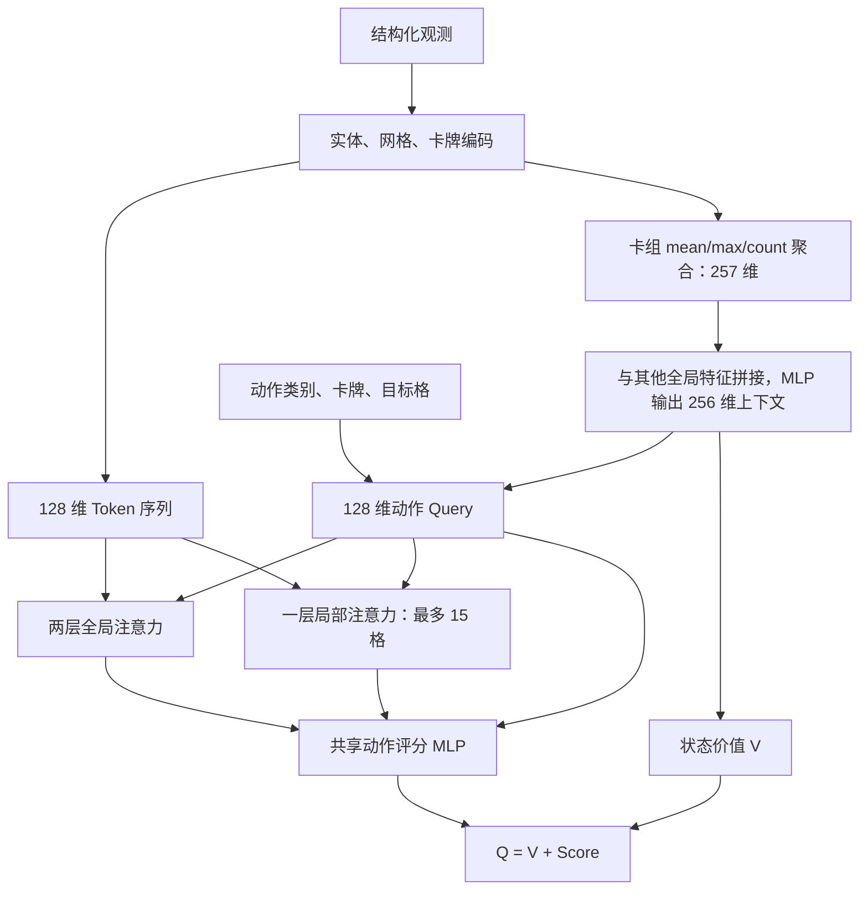

# Double DQN 算法与工程报告

本报告解释真实游戏环境中的算法选择与实现边界。参数和接口的完整说明见
[DQN 参考](../docs/dqn_reference.md)，观测、动作、奖励及原生时钟分别以各自契约为准。
历史训练统计与待验证的研究假设分开说明。

## 1. 问题建模

战斗动作空间固定为 757：NOOP、10 卡槽 × 6 行 × 9 列用卡、两层铲除、
玉米炮目标和预留交互。实际场景为 5 或 6 行，非法行及当前不可执行动作由原生
掩码屏蔽。选卡阶段另有 193 动作，不与战斗动作混合。小车自动触发，没有独立
“小车动作”。详见 [动作契约](../docs/action_space.md)。

观测不是图像：植物保留底座、主体、南瓜三层；僵尸保留类别、阶段、护甲与控制
状态；Boss 本体去除占位几何，冰火球是保留真实位置的独立实体。
固定网格上限为 6×9，不能按仅有 5 行的棋盘解释泳池和浓雾输入。

决策间隔使用实际推进的游戏 tick。主循环加速与模型墙钟耗时是不同时间尺度，
不能用 Turbo 倍数或 CPU/GPU 耗时替代回报折扣中的游戏时间。

## 2. Double DQN、tick 折扣与 Replay

Online 网络在下一状态的合法集合中选择动作，Target 网络评估该动作：

$$a^*(s')=\arg\max_{a\in\mathcal A_{legal}(s')}Q_{online}(s',a)$$

$$y=R_m+D_m(1-\mathrm{terminated})Q_{target}(s',a^*(s'))$$

默认每 2000 次梯度更新硬同步 Target。真实终止关闭 bootstrap；预算截断保留
bootstrap，不能把 `truncated` 合并为死亡。当前信用分配默认 `one_step`，
时间累积默认仍使用 `n_step=3`，两者是不同配置维度。

令 $\Delta ticks_t$ 为该 transition 实际推进的游戏 tick，则：

$$d_t=\gamma^{\Delta ticks_t/100},\qquad \gamma=0.999$$

$$D_0=1,\quad D_k=\prod_{i=0}^{k-1}d_{t+i},\quad
R_m=\sum_{k=0}^{m-1}D_kr_{t+k}$$

100 ticks 是折扣基准，不是固定每步推进量。临近 episode 边界时 $m$ 可以小于 3。
不同 Worker 的 episode 链彼此隔离，不能把相邻写入槽误作相邻时间步。

默认 Replay 容量为 200,000，SumTree PER 为：

$$p_i=|\delta_i|+10^{-5},\qquad P(i)=\frac{p_i^{0.6}}{\sum_jp_j^{0.6}}$$

$$w_i=(NP(i))^{-\beta},\qquad \bar w_i=w_i/\max_j w_j$$

$\beta$ 从 0.4 向 1.0 退火。未形成完整 n-step 链、且尚未到 episode 边界的
尾部样本不进入可抽样集合；PER 回写检查 transition ID，跳过已经覆盖的槽位。
加权 Smooth L1 用于 TD 更新。字段压缩、内存估算、流封闭与检查点冻结详见
[Replay 设计](../docs/replay_memory.md)。

## 3. 当前 v9 网络

网络标识为 `entity_action_global_local_attention_card_set_128_2global_v9`。
128 维实体/格子/卡牌 Token 和动作 Query 共享编码器及动作评分器；当前网络没有 CNN。



卡槽只定位原生动作，卡组上下文采用 masked mean/max 与数量聚合，没有槽位
embedding。局部通道读取目标整行及目标列上下两行的邻域，最多 15 格；远程实体
通过全局通道进入。格子 Token 保留三层植物、地形、小车及僵尸汇总。

`Q=V+Score` 不减去全动作 Score 的均值，不能照搬经典 dueling 的均值中心化公式。
按默认 `(512,256)` hidden sizes、奖励上下文及 Boss 球输入构建的当前模型有
**892,046 个参数**；参数量本身不能证明网络已经达到容量瓶颈。

训练时 Current 网络只评分已执行动作，Target 只评分 Online 选出的下一动作；
**Online 的下一状态 argmax 仍须评分全部合法候选**。实现按批次打包合法 ID，
减少无效动作的注意力展开，保留 NOOP 和空集合回退。优化效果要用相同 Replay、
batch、设备与精度比较，并检查 loss/TD 一致性；这里不承诺固定吞吐量倍数。

## 4. 探索与奖励

贪心选择先屏蔽非法动作。探索分支默认一半随机、一半 Q-guided；随机策略先按
动作家族先验选家族，再在该家族内均匀选合法动作，并非在整个合法集合内均匀抽样。
默认种植/NOOP/铲除先验分别为 4.0/2.0/0.1，其余配置见
[探索参考](../docs/dqn_reference.md)。掩码保证当前动作合法，不保证战术最优。

默认奖励是 `transition_dense`，采用胜负、小车与资产/伤害/威胁变化。
默认 `smooth_total` 约束整局净塑形在 ±0.4 内，正负变化可以相互抵消。
击杀、植物阵亡与分阶段奖励属于其他可选预设，不应混入默认公式。
完整系数、伤害预算与奖励输入见 [奖励规范](../docs/rewards.md)。

## 5. Actor–Learner 数据流

```mermaid
sequenceDiagram
    participant Worker as 游戏 Worker
    participant Actor as 主控 Actor
    participant Replay as Replay
    participant Learner as 后台 GPU Learner
    Worker-->>Actor: 环境观测与上一步结果
    Actor->>Replay: 写入 transition 与 episode 链
    Actor->>Actor: 推理、掩码与探索
    Actor->>Worker: 派发动作
    Actor->>Learner: 发放训练额度
    Learner->>Replay: 加锁抽样并复制 batch
    Learner->>Learner: TD 更新
    Learner->>Replay: 核对 transition ID 后回写 PER
    Learner-->>Actor: 发布不可变权重快照
    Actor->>Actor: 在动作批次边界加载快照
```

多进程 Worker 操作游戏，不各自运行训练网络。Actor 和后台 Learner 位于同一
主控 Python 进程，模型与 CUDA stream 分离。Replay 操作和权重发布使用同步机制；
推理不持有 Learner 的模型锁，不意味着整套架构无锁。

未完成更新数达到 `max_pending_updates` 时暂停派发，继续接收在途结果；
Policy Lag 则限制 Learner 相对 Actor/在途动作的更新版本差。动态 `train_every`
是另外一项调度机制，不能把这三者混为“Replay 堆积时自动减少训练”。

滚动 autosave 是 model-only，完整 checkpoint 另含配对 Replay。恢复模式、奖励
兼容与训练额度有独立契约，游戏 Board 不精确恢复。详见
[异步架构](../docs/actor_learner_async.md)与 [保存加载](../docs/dqn_reference.md)。

## 6. 一组历史训练统计

截至 2026-10-11 核对的 `double-dqn-40常规关卡` 日志包含 9,090 条 episode 记录，
训练约 270 万环境步。关卡为一周目的 40 个常规关，排除每大关第 5、10 关。
该 Run 使用自适应混合采样；这不是当前默认参数的一次重新训练。

按 JSONL 记录顺序，对每个 `(level, playthrough)` 取末尾 80 条记录：
共 3,200 局，2,276 胜，约 **71.1%**。窗口里的 epsilon 为 **0.04–0.134981925**，
不能全部写成“4% 探索”。这是训练对局胜率，不是固定种子 greedy 评估。

| 场景 | 所含常规小关 | 各关末尾 80 局合计 | 窗口胜率 | 全部记录战绩 | 全部记录胜率 |
| --- | --- | --- | --- | --- | --- |
| 白天草坪 | 1–4、6–9 | 469/640 | 73.28% | 1005/1752 | 57.36% |
| 夜间草坪 | 1–4、6–9 | 460/640 | 71.88% | 893/1549 | 57.65% |
| 泳池 | 1–4、6–9 | 444/640 | 69.38% | 910/1978 | 46.01% |
| 浓雾 | 1–4、6–9 | 451/640 | 70.47% | 881/1795 | 49.08% |
| 屋顶 | 1–4、6–9 | 452/640 | 70.62% | 911/2016 | 45.19% |

原始日志 SHA256 为：

```text
d54996c012756219a0e7ce73dd559f3cb524b601917f2d5c346e7b11f8cc9e34
```

原始日志、checkpoint 和 Replay 不随仓库发布。此摘要可用于保存统计口径，
无法独立重放该实验。各关窗口来自不同训练时段、自适应采样量也不同；场景均值
接近不能证明每个关卡都稳定，也不能证明当前 checkpoint 的独立评估胜率。
本报告不保留缺少配对日志与评测协议的单关“75%–100%”等性能断言。

## 7. 故障分析与实验方法

下列问题是诊断候选，不能仅凭上面的总体胜率认定为已证实的原因。

| 问题 | 需要观察的证据 |
| --- | --- |
| 大动作集合的价值竞争 | 每状态实际合法动作数、最佳/次佳 Q 差及重复训练方差；固定 757 不等于每步有 757 个候选 |
| 极值偏差 | 同状态 Q 与后续回报的偏差，区分估计噪声、探索和环境读取错误 |
| 长尾动作校准 | Replay 中动作/卡组/关卡覆盖，以及相应合法且可负担的机会数 |
| 长程信用分配 | 早期经济动作到胜负的间隔，匹配预算下的 n-step/奖励对照 |
| Loss 与胜率脱节 | 固定种子 greedy 结果与 loss 分开绘图，注明每关样本数和截断 |
| 成型防线被铲除 | 同状态 `Q(shovel)`、`Q(NOOP)`、即时奖励与未来 TD 目标，并核对重种收益；不能由负即时奖励单独解释 |
| 组合植物技能不足 | 卡组是否包含前置卡、解锁是否合法、资源/位置是否允许以及实际操作序列 |
| 经济与后期预留不足 | 开局经济、预算、后期波次与死亡场景；greedy Q 决策不等于只优化即时收益 |
| 辅助植物未使用 | 路灯花/大蒜等可用机会、雾输入变化与实际回报，避免把卡组缺失归因于算法 |
| 战术多样性不足 | 相同条件不同种子下阵型、动作分布和胜率，而非仅看一次对局 |
| 遗忘与负迁移 | 保留旧关固定评估集，比较更新前后每关性能和 Replay 分布 |
| 多任务容量不足 | 匹配采样、优化步数和计算预算的容量对照；平台期不能直接证明容量瓶颈 |
| 跨场景泛化不足 | 明确训练/测试场景、卡组和零样本协议；夜间无天降阳光，但向日葵仍可产阳光 |
| 选卡与战斗配合不足 | 区分课程预设选卡和学到的战斗策略，逐关核对卡组、周目及戴夫锁卡 |

## 8. 待验证方向

当前实现可用作基线。后续可比较 CNN/注意力及同行特征、技能子任务、专家蒸馏和
模型容量，但这些都需要同条件实验，不能预先写成结论或现有功能。

空间编码比较应固定网络其余部分、Replay 与参数/计算预算；容量实验还应记录
显存、Learner 更新速度及每关 greedy 胜率。技能课程需先定义任务成功条件，
蒸馏需定义专家数据来源与评价方法。任何奖励或输入改动均须检查 checkpoint
兼容性，完整恢复保留原关卡池。

泳池无尽、精密组合战术与更强的跨场景泛化是长期研究目标；本仓库不提供已经
验证的无尽训练、专家蒸馏或分层技能流程。

相关实现细节：[观测](../docs/observation.md)、[动作](../docs/action_space.md)、
[奖励](../docs/rewards.md)、[自适应采样](../docs/adaptive_level_sampling.md)、
[原生 API](../docs/native_api.md)、[构建与测试](../docs/development.md)。
